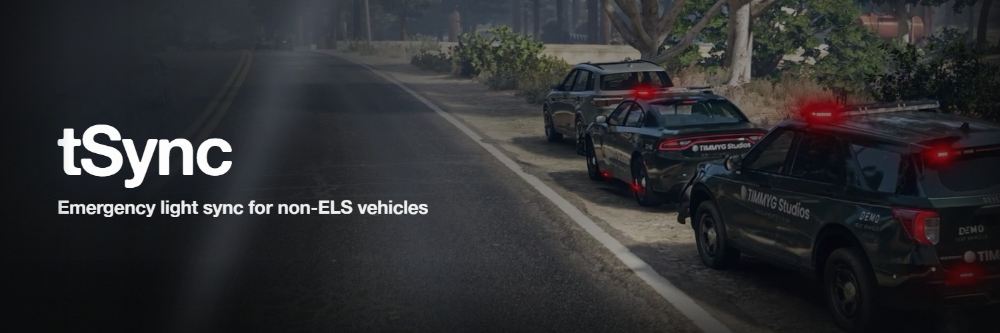

# tSync

Brings nearby emergency lights back into step. Free, MIT, and it needs
[tLib](https://github.com/tommy141x/tLib) v1.0 or newer.

GTA runs every vehicle's light pattern off a timer that starts when its siren
comes on. Two cars that lit up a second apart flash a second apart for as long
as they are lit, and nothing in the game ever pulls them together. tSync
restarts those timers together.

It is for the **non-ELS** world — vanilla lights, Luxart Vehicle Control,
Ultimate Lighting Controller, and anything else that lets GTA draw the lights.

## Install

1. Install [tLib](https://github.com/tommy141x/tLib/releases) first.
2. Drop the folder into `resources/`, named exactly `tSync` — no spaces, no
   `-main` suffix.
3. Add `ensure tSync` to `server.cfg`, **after** `ensure tLib`.
4. Restart.

That is the whole installation. tSync runs with zero edits.

## Configuration

Everything lives in `config.lua`, commented in full. Five settings:

| Key                | Default  |                                                                   |
| ------------------ | -------- | ----------------------------------------------------------------- |
| `intervalMs`       | `5000`   | how long two vehicles may drift before being pulled back together |
| `radius`           | `150.0`  | metres; beyond this they are not legible anyway                   |
| `vehicleClasses`   | `{ 18 }` | 18 is Emergency. Add 19 for Military                              |
| `vehicleBlacklist` | `{}`     | spawn codes never to sync                                         |
| `vehicleWhitelist` | `{}`     | sync only these spawn codes; replaces the class check             |

Changes need a resource restart. A mistyped key is reported at boot, naming the
key and the fix, and your file is never rewritten.

Deferring to another lighting script has no setting — it is automatic.

## What it does and does not do

A vehicle is re-phased when its lights are **already on**, its spawn code passes
the two lists, it is within `Config.radius`, and no other lighting script claims
it.

tSync never switches lights on, changes a pattern, or touches a vehicle lit by a
script that draws its own LEDs — there is no engine timer behind those to
restart. If you run [tLS](https://timmygstudios.com/software/tls), tSync stays
out of its way automatically.

## Is it working?

Run `tsync_diag` in the client console (F8). It reports the resolved settings,
what it is deferring to, and how many vehicles the last pass re-phased.

A count of zero with vehicles clearly lit around you means they are failing one
of the four rules above — most often `vehicleClasses`, if the fleet is not class
18. The [troubleshooting page](https://timmygstudios.com/docs/tSync/troubleshooting)
walks them in order.

## How it works

There is no server component to the sync, deliberately.

The reset is **per-observer**: it re-phases what your own client draws,
including vehicles you do not own. Nothing is replicated and nothing needs to
be — every client already shares `GetNetworkTimeAccurate()`, so each one crosses
the same interval boundary at the same instant and arrives at the same result on
its own. No net events, no broadcast, nothing to forge.

## Licence

MIT. See `LICENSE`.
